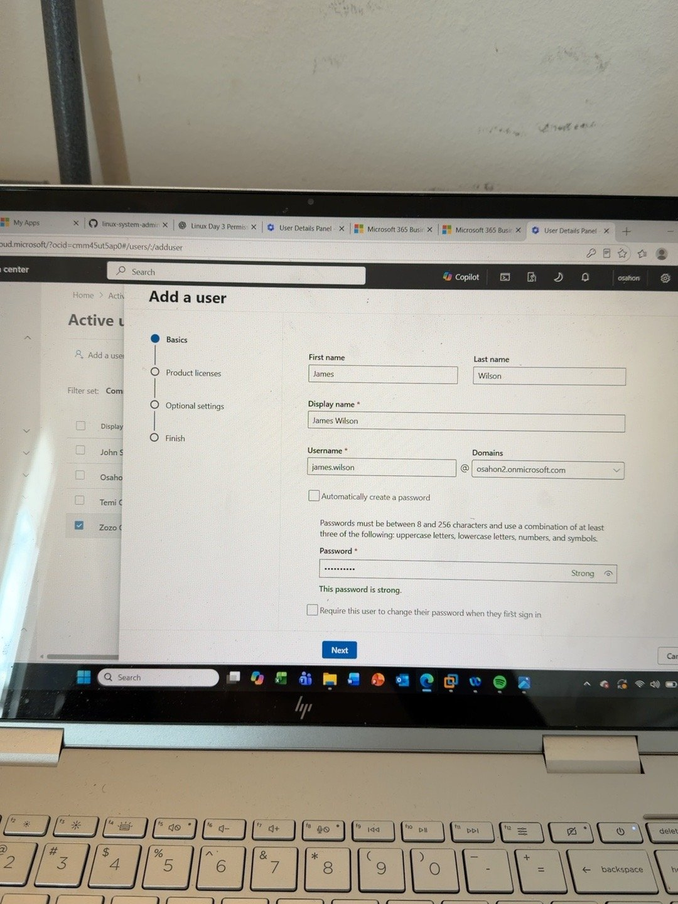
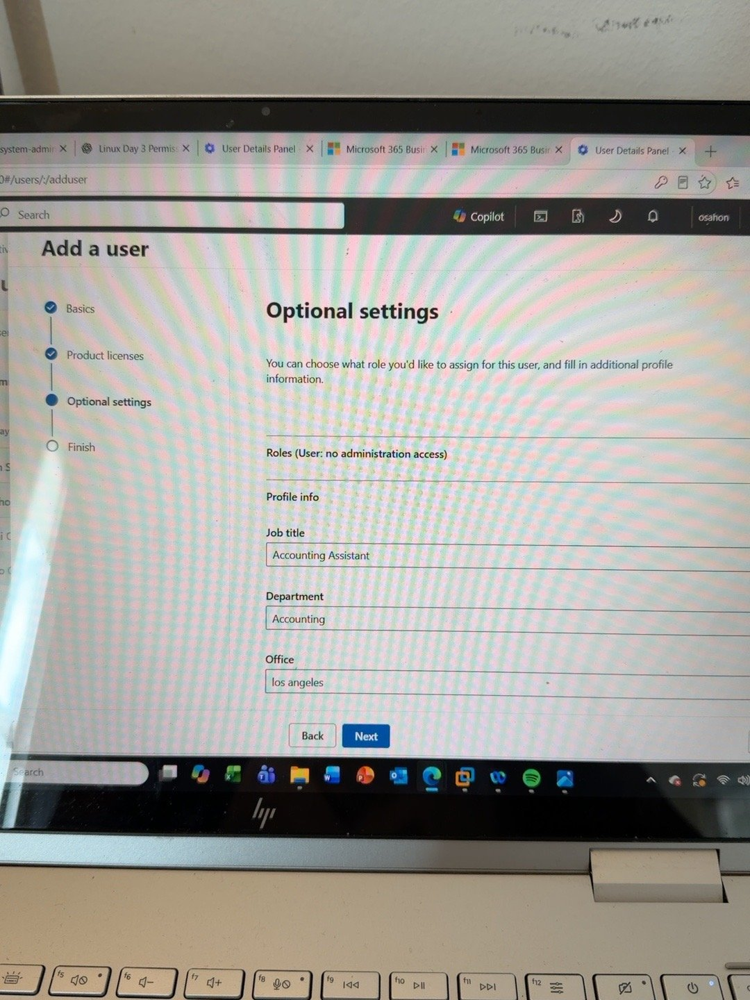
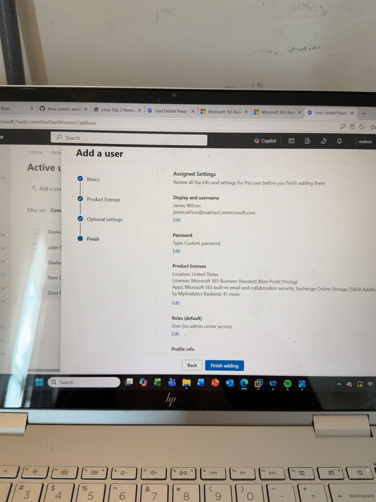
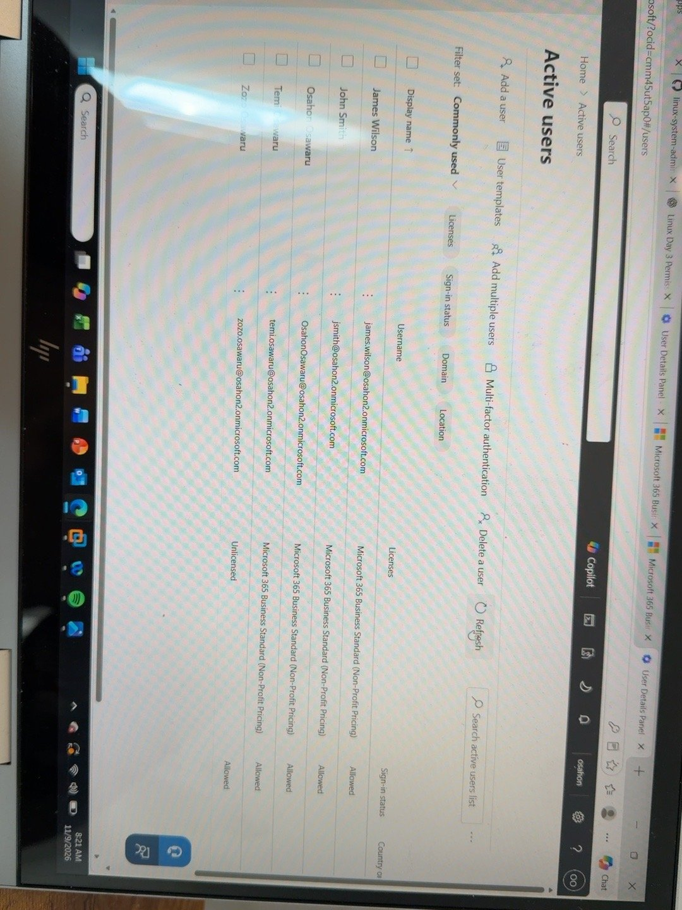
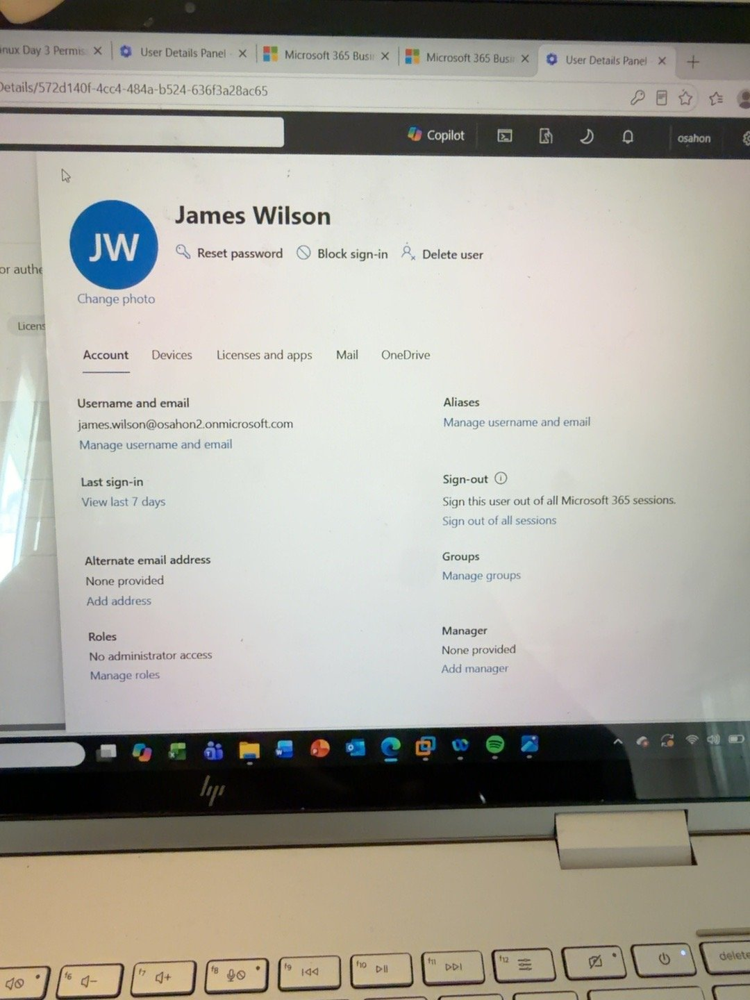
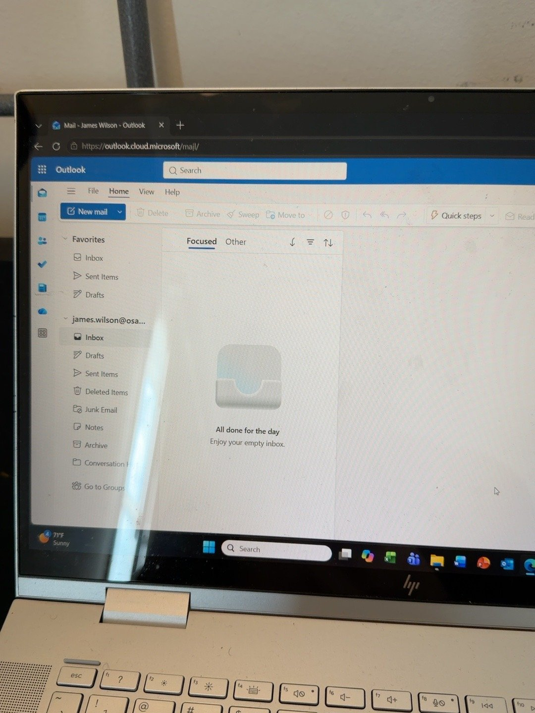
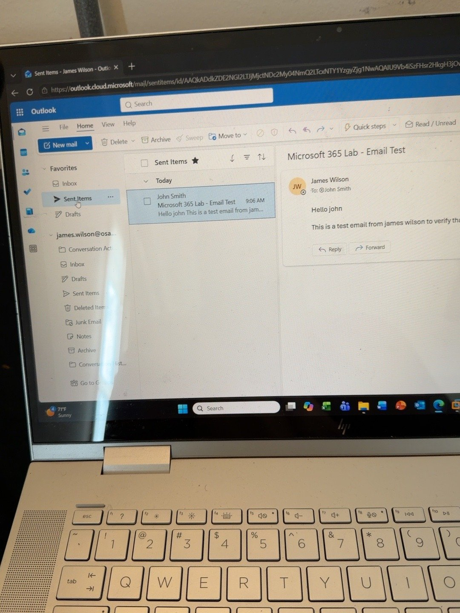
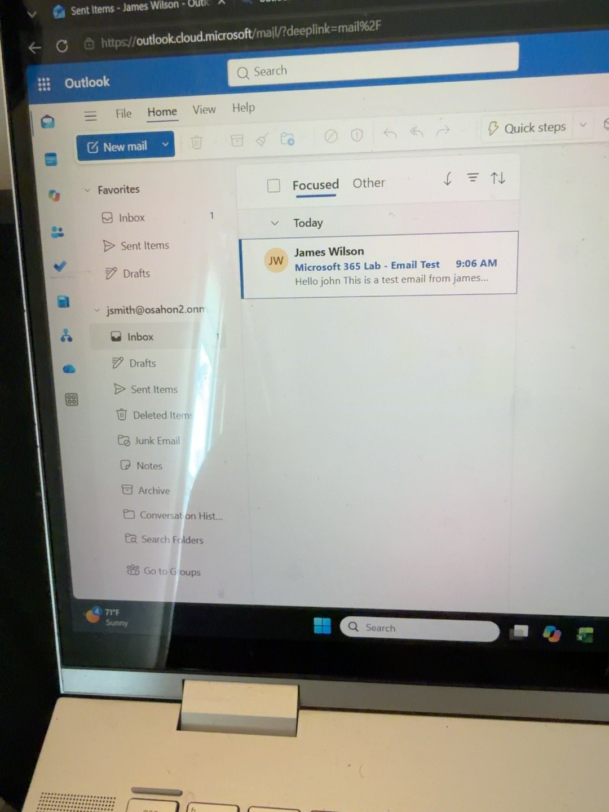

# Microsoft 365 User Onboarding — Hands-On IT Support Lab

**Course:** Dan Mills — Ultimate System Administrator, Section 8, Lecture 126  
**Lab ID:** 003 / IT Support Ticket #006  
**Platform:** Microsoft 365 Admin Center, Microsoft Entra ID, Exchange Online, Outlook on the web  
**Lab scope:** Cloud-only test user in an existing Microsoft 365 tenant  
**Result:** User creation, license assignment, standard-user role, Outlook access, and internal email delivery verified

## 1. Overview / Problem Statement

In this hands-on lab, I simulated a new-employee onboarding request for **James Wilson**, a fictional Accounting Assistant at a fictitious company. The goal was to provision an appropriately licensed Microsoft 365 account, avoid unnecessary administrative permissions, verify that the test user could sign in, and test email delivery between two accounts in the same tenant.

This lab documents what I performed in the Microsoft 365 Admin Center, the problems encountered during testing, how I worked around them, and the evidence used to verify the outcome.

## 2. Learning Objectives

- Create a cloud user account in **Users → Active users**.
- Configure identity details and a Microsoft 365 license.
- Distinguish **user identity**, **license entitlement**, and **resource permissions**.
- Apply the **principle of least privilege** by avoiding Global Administrator access for an ordinary employee.
- Complete the test account's authentication setup and verify access to Outlook on the web.
- Test internal email delivery and document the evidence.

## 3. Lab Environment

| Component | Configuration |
|---|---|
| Tenant | Existing Microsoft 365 test tenant (`osahon2.onmicrosoft.com`) |
| Admin portal | `https://admin.microsoft.com` |
| Identity platform | Microsoft Entra ID |
| License assigned | Microsoft 365 Business Standard (Non-Profit Pricing), as shown in the lab wizard |
| Test employee | James Wilson — Accounting Assistant |
| Test sign-in | `james.wilson@osahon2.onmicrosoft.com` |
| Test recipient | John Smith — `jsmith@osahon2.onmicrosoft.com` |
| Email client | Outlook on the web |
| Device | Windows laptop / Microsoft Edge |

> **Security note:** All employee personas used here are lab accounts. No passwords, MFA secrets, tokens, or recovery codes are included in this repository. The screenshots contain the test tenant's name and account identifiers; review them before publishing if a more anonymous public portfolio is desired.

## 4. Ticket Details

**Ticket:** #006 — New Employee Onboarding  
**Reported request:** Provision a Microsoft 365 account for a newly hired Accounting Assistant, with the email and collaboration services needed for their job and **no administrator privileges**.  
**Authorized onboarding:** Assumed for this fictional training ticket; in a real organization, I would verify HR/manager approval and the exact access requirements before provisioning.

**Acceptance criteria:** The account exists; intended license is assigned; administrative role remains standard user; the user can sign in to Outlook; an internal test message can be sent and received.

## 5. Implementation — Step by Step

### Step 1 — Opened the Add User wizard

In the **Microsoft 365 Admin Center**, I navigated to **Users → Active users → Add a user**.

I entered the employee's first name, last name, display name, and username, selecting the tenant's existing `onmicrosoft.com` domain.

**Why:** The User Principal Name (UPN) identifies the account for sign-in. A new cloud account does not inherently grant every paid service or every resource permission.

*Evidence 1: Basics page with James Wilson's identity details and tenant domain.*

### Step 2 — Configured the license

In **Product licenses**, I selected the **United States** usage location and **Microsoft 365 Business Standard (Non-Profit Pricing)**. The final review screen confirmed the license choice.

**Why:** Account creation provides an identity; license assignment gives entitlement to included services such as Exchange Online, subject to service-plan configuration and provisioning. Licenses do not automatically grant SharePoint document access.

### Step 3 — Applied least-privilege role and profile details

In **Optional settings**, I left the role as **User (no administration access)** and added:

| Field | Lab value |
|---|---|
| Job title | Accounting Assistant |
| Department | Accounting |
| Office | Los Angeles |
| Role | User — no administrative access |

**Why:** The employee needs to use services, not administer the tenant. Department and job title are profile attributes, **not automatic permissions** to company files.

*Evidence 2: Optional settings with a standard-user role and profile information.*

### Step 4 — Reviewed and created the account

I checked the final summary for the intended **username, license, location, and non-admin role**, then completed the wizard. The password was not captured in this repository.

*Evidence 3: Final user-creation review showing Microsoft 365 Business Standard and no admin-center access.*

### Step 5 — Verified the account and role

After creation, I returned to **Users → Active users** and confirmed that **James Wilson** appeared. I opened the account's **Account** tab and verified **Roles: No administrator access**.

*Evidence 4: James Wilson appears in the Active users list with the assigned subscription.*

*Evidence 5: Account details indicate no administrator access.*

### Step 6 — Verified Outlook sign-in

I tested the new account at `https://outlook.office.com/mail/`. MFA registration was completed as part of the lab. After signing in as James in a separate **Edge InPrivate** session, the mailbox loaded successfully.

*Evidence 6: James Wilson's Outlook on the web mailbox loads successfully.*

### Step 7 — Tested internal email sending and delivery

From James's mailbox, I sent a test message to **John Smith** (`jsmith@osahon2.onmicrosoft.com`) with the subject **Microsoft 365 Lab - Email Test**.

I confirmed the message appeared in **James's Sent Items**, then opened John's mailbox and verified that the same message arrived in **John's Inbox**.

*Evidence 7: James's Sent Items shows the outgoing test email.*

*Evidence 8: John's Inbox shows the received test email.*

## 6. Troubleshooting Encountered

| Issue observed | Investigation / action | Result |
|---|---|---|
| Opening the Microsoft 365 home page led to the Copilot experience | Navigated directly to Outlook on the web instead of relying on the general landing page | Reached the email application |
| Outlook initially opened the existing administrator mailbox instead of James's | Recognized the browser was reusing an authenticated session; tested James in an **Edge InPrivate** session | Correct test user signed in |
| Sending a message alone did not prove end-to-end delivery | Checked the **Sent Items** folder and then the recipient's **Inbox** | Internal message delivery verified |

**Troubleshooting principle:** Identify which user session is active, isolate the test environment, verify the result from both sender and recipient perspectives, and avoid unnecessary account or license changes.

## 7. Verification Checklist

| Verification | Evidence / result |
|---|---|
| Test user appears in Active users | **Pass** — screenshot 4 |
| Intended Microsoft 365 Business Standard license assigned | **Pass** — final review and users list |
| No administrator privileges | **Pass** — screenshot 5 |
| Outlook on the web sign-in | **Pass** — screenshot 6 |
| MFA registration | **Completed during lab** — user-confirmed, no confidential setup evidence shared |
| Message appears in James's Sent Items | **Pass** — screenshot 7 |
| Message arrives in John's Inbox | **Pass** — screenshot 8 |
| External-domain email delivery | **Not tested** |
| Accounting SharePoint permissions | **Not configured or tested** |
| Secure credential handoff to a real employee | **Not applicable** — fictional lab user |

## 8. What I Learned

1. **Creating a user is not the same as assigning a license.** The account establishes identity; the license enables entitlement to subscription services.
2. **Profile fields are not access control.** Setting Department to Accounting does not automatically provide access to Accounting files.
3. **Global Administrator privileges are not appropriate for regular employees.** Least privilege reduces security risk.
4. **Authentication and application availability must be tested after provisioning.** A user appearing in Active users does not prove Outlook works.
5. **Sent Items does not guarantee delivery.** Checking the recipient's Inbox provides stronger evidence for this internal test.
6. **Browser sign-in sessions can affect troubleshooting.** InPrivate browsing helped test the intended account instead of the previously signed-in administrator.

## 9. Outcome and Next Steps

**Outcome:** The fictional new employee's account was provisioned successfully. The role and license were confirmed, the user signed in to Outlook, and an internal test email was received by another test account. The lab satisfies its stated acceptance criteria; it does **not** demonstrate external mail flow or Accounting SharePoint access.

**Next lab:** Dan Mills Lecture 127 — create and manage Microsoft 365 groups; compare Microsoft 365 groups and security groups; practice group membership and access verification.

---

*Portfolio note: This is a hands-on training lab using fictional employee personas and a test Microsoft 365 tenant. It is not a claim of performing onboarding in a production employer environment.*
