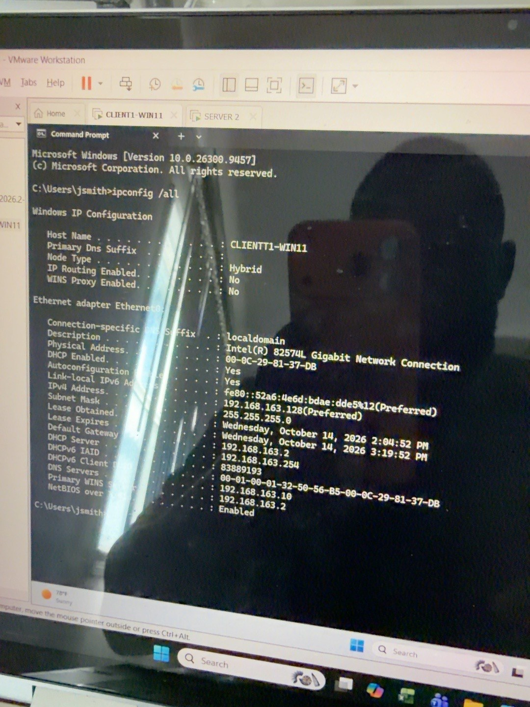
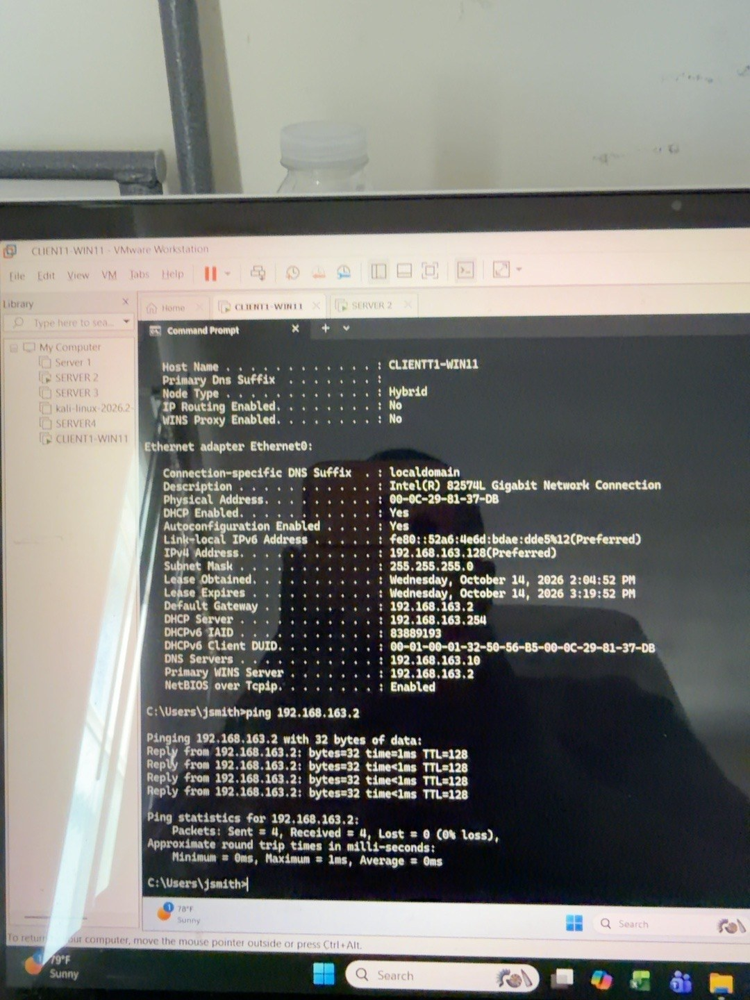
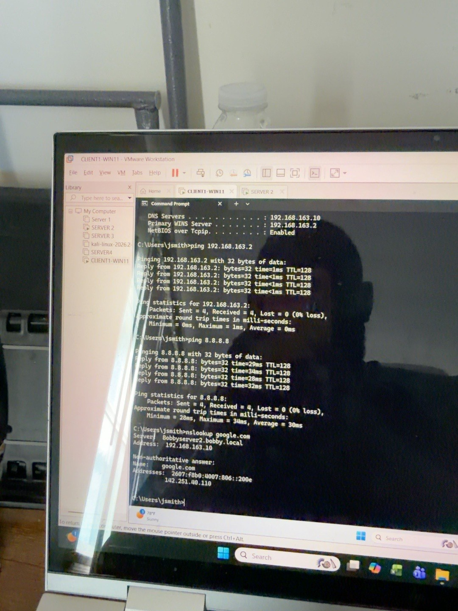
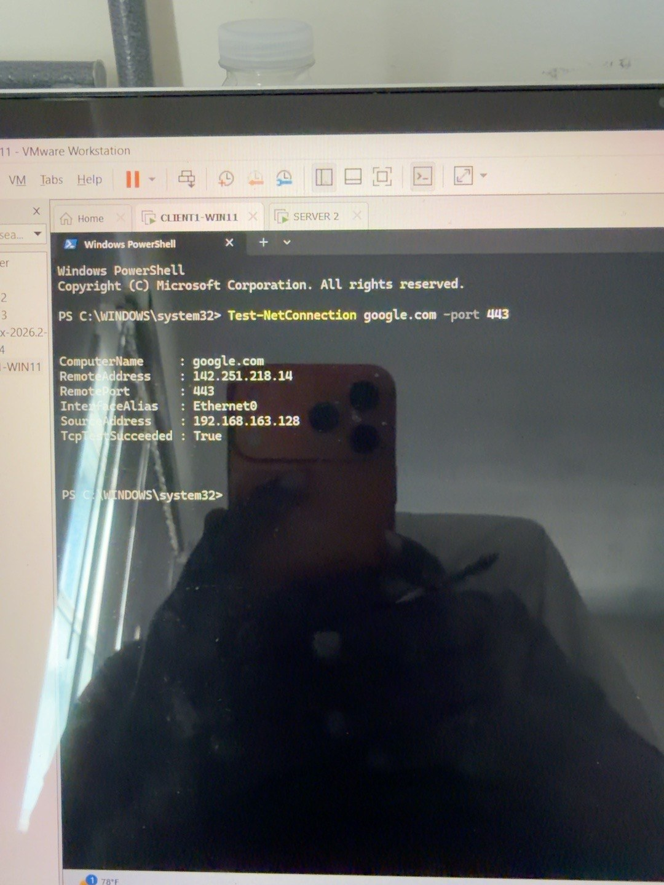
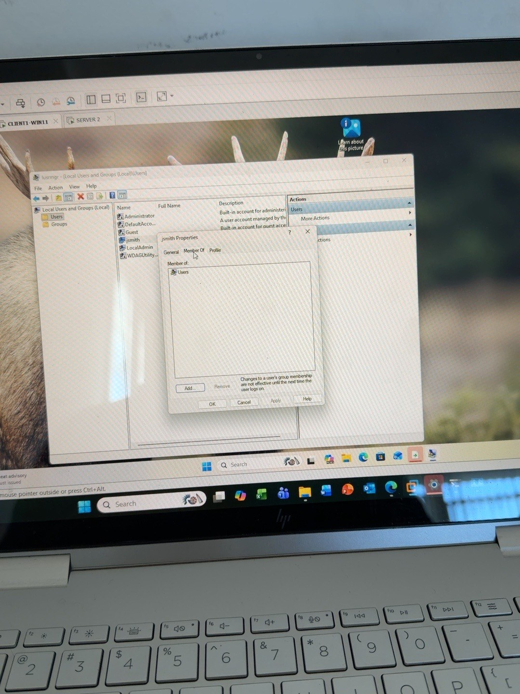
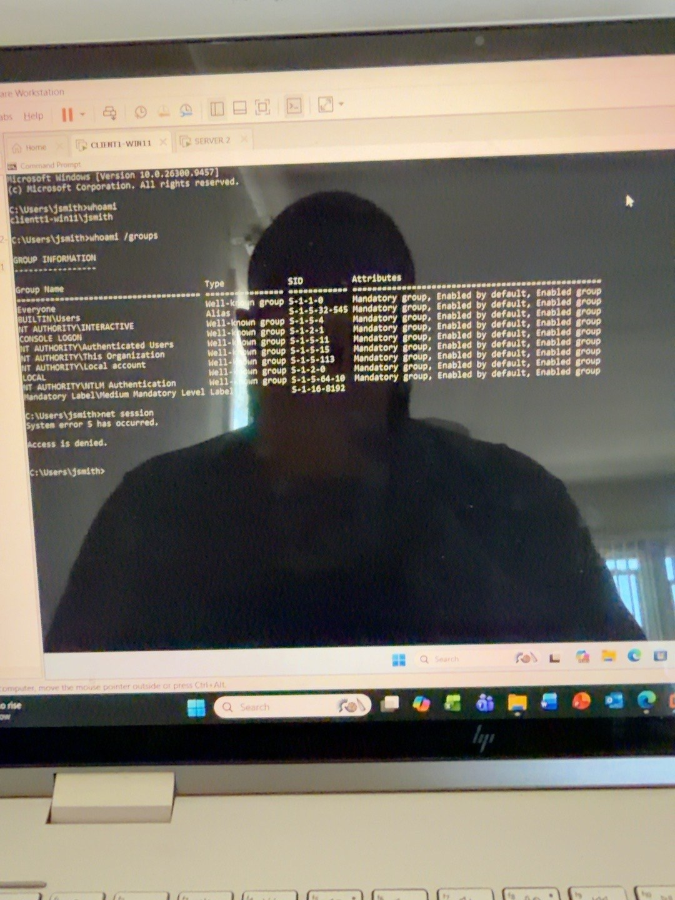
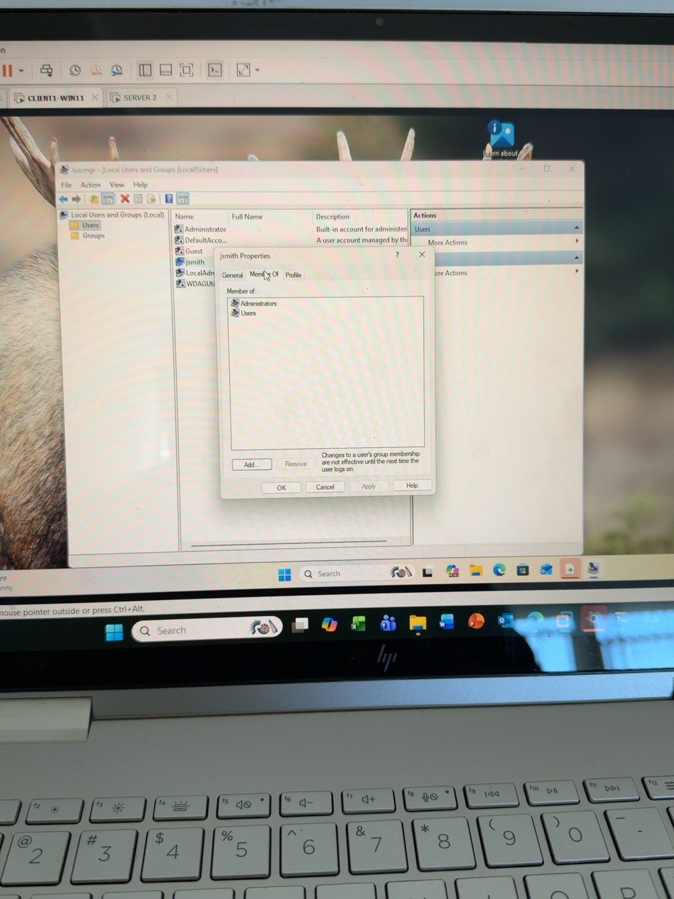

# Windows 11 IT Support & Network Troubleshooting Lab

## Overview

This home lab demonstrates practical Windows 11 help desk skills:
network diagnosis, local account permissions, User Account Control
(UAC), Windows Services, Event Viewer, and support-ticket documentation.

**Environment:** VMware Workstation; `CLIENT1-WIN11` (Windows 11);
`SERVER2` (`bobby.local` DNS server).

> **Accuracy note:** The network tests passed and Google opened in Edge.
> The APIPA/DHCP incident below is a simulated ticket, **not** an actual
> failure or repair performed in this lab.

## 1. Network configuration

I ran `ipconfig /all` in Command Prompt and observed:

  Setting           Observed value
  ----------------- -----------------------------------------
  Computer          `CLIENT1-WIN11`
  IPv4 address      `192.168.163.128`
  Subnet mask       `255.255.255.0`
  Default gateway   `192.168.163.2`
  DHCP enabled      Yes
  DHCP server       `192.168.163.254` (VMware virtual DHCP)
  DNS server        `192.168.163.10` (`SERVER2`)



**Lesson:** DHCP assigns network settings; DNS translates names to IP
addresses; the gateway routes traffic outside the local network. The
VMware DHCP server and Windows Server DNS server were separate systems.

## 2. Connectivity troubleshooting

### Step 1 --- Ping the gateway

``` cmd
ping 192.168.163.2
```

**Result:** Four replies, 0% loss. **Meaning:** The gateway was
reachable.



### Step 2 --- Ping an external IP

``` cmd
ping 8.8.8.8
```

**Result:** Four replies, 0% loss. **Meaning:** External IP connectivity
worked; this does not prove DNS or browser access.

### Step 3 --- Resolve a hostname

``` cmd
nslookup google.com
```

**Result:** DNS server `192.168.163.10` responded with Google IP
addresses. **Meaning:** Public DNS name resolution worked.



### Step 4 --- Test HTTPS TCP connectivity in PowerShell

``` powershell
Test-NetConnection google.com -Port 443
```

**Result:** `TcpTestSucceeded : True`,
`SourceAddress : 192.168.163.128`, `RemotePort : 443`. **Meaning:** A
TCP connection to port 443 succeeded; it does not independently prove
the browser or HTTPS page works.



**Learning moment:** I initially tried `Test-NetConnection` in Command
Prompt, where it was not recognized. I switched to **PowerShell**, which
supports this cmdlet.

### Step 5 --- Verify browser access

Opened Microsoft Edge and visited `https://www.google.com`.

**Result:** Google loaded successfully. **Conclusion:** No browser or
network repair was necessary in this test.

## 3. Local users and permissions

I used `lusrmgr.msc` to manage local Windows 11 accounts and examined
`jsmith` as a standard user. In a controlled lab I temporarily added
`jsmith` to `Administrators`, then removed that membership to restore
least privilege.

Commands practiced:

``` cmd
whoami /groups
net session
```

As a standard user, `net session` produced
`System error 5. Access is denied.` In an elevated administrator Command
Prompt, the command ran and returned `There are no entries in the list.`
This illustrates the difference between standard and elevated privileges
and the role of UAC.







*The last screenshot shows a temporary test configuration, not the final account permissions.*

## 4. Services and Event Viewer

Opened the Windows Services console using `services.msc`. Investigated
the **Print Spooler** service with:

``` powershell
Get-Service Spooler
Stop-Service Spooler
Start-Service Spooler
Restart-Service Spooler
```

Opened Event Viewer with `eventvwr.msc`. Reviewed System/Application
events, including Service Control Manager event concepts (7036/7040) and
a `Security-SPP` application event 8198 related to Windows activation
error `0x803F7001`. A filter for 7036 returned no matching events in the
observed view; do not claim it was present.

**Lesson:** Review actual log evidence and distinguish licensing errors
from network problems. Service control generally requires appropriate
elevation.

## 5. Simulated support ticket: DHCP / APIPA

**Employee report:** "My computer has `169.254.20.15` and cannot connect
to the company network."

**Likely cause to investigate:** The client could not obtain a DHCP
lease and assigned itself an APIPA address (`169.254.x.x`). This does
not automatically prove the DHCP server itself is down.

**Proposed workflow:**

1.  Inspect adapter connectivity and `ipconfig /all`.

2.  Check whether other devices are affected.

3.  If appropriate, try:

    ``` cmd
    ipconfig /release
    ipconfig /renew
    ipconfig /all
    ```

4.  If APIPA persists, investigate DHCP reachability, scope
    availability, virtual network settings, and physical/network path.

5.  Verify the new address, gateway, DNS, and connectivity.

**Status:** This was a scenario-based quiz; the renewal commands were
discussed but **not demonstrated as a fix for an actual outage**.

## 6. Troubleshooting quick reference

  -----------------------------------------------------------------------
  Symptom                             Next area to investigate
  ----------------------------------- -----------------------------------
  `169.254.x.x`                       DHCP, adapter, local network

  Gateway ping fails                  Local link, IP/subnet, gateway

  External IP ping fails              Routing, firewall, upstream network

  IP works but hostname fails         DNS

  DNS and port 443 work, but browser  Proxy, browser settings/extensions,
  fails                               TLS and exact error

  `Access is denied` on admin command Account membership, UAC, elevation

  Service fails                       Service state, dependencies, Event
                                      Viewer
  -----------------------------------------------------------------------

## 7. Example help desk ticket

**Ticket:** Windows 11 website connectivity verification\
**Device:** `CLIENT1-WIN11`\
**Reported issue:** Practice investigation of potential website access
failure\
**Troubleshooting:** Checked IP/DHCP/DNS/gateway, pinged gateway and
external IP, ran `nslookup`, tested TCP 443 in PowerShell, opened Google
in Edge.\
**Findings:** All tests passed; website loaded.\
**Resolution:** No corrective action required; access verified.\
**If issue recurs:** Record URL, error message, time, browser, and
affected devices.

## 8. Screenshot evidence

The seven screenshots above are original photographs shared during the hands-on Windows 11 labs. They show the IP configuration, successful gateway ping, external ping and DNS query, PowerShell port 443 test, standard-user group membership, denied administrative command, and temporary administrators-group membership for the controlled permissions exercise.

Screenshots of the Edge browser check, Print Spooler, and Event Viewer are **not included** in this package. These activities are described in the lab notes, but no images are invented.

> Before publishing a public portfolio, review screenshots for any information or reflections you do not want to share.

## 9. Skills demonstrated

Windows 11 account administration, least privilege, UAC, Services, Event
Viewer, `ipconfig`, `ping`, `nslookup`, PowerShell `Test-NetConnection`,
DNS/DHCP/gateway reasoning, browser checks, and help desk ticket
documentation.

## 10. Repetition challenge

Without referring to these instructions, identify the client
IP/gateway/DNS/DHCP server; test the gateway, external IP, DNS, TCP 443,
and browser; explain what each test proves; and write a concise support
ticket.

*This is a personal training lab, not a claim of paid production IT
work.*
